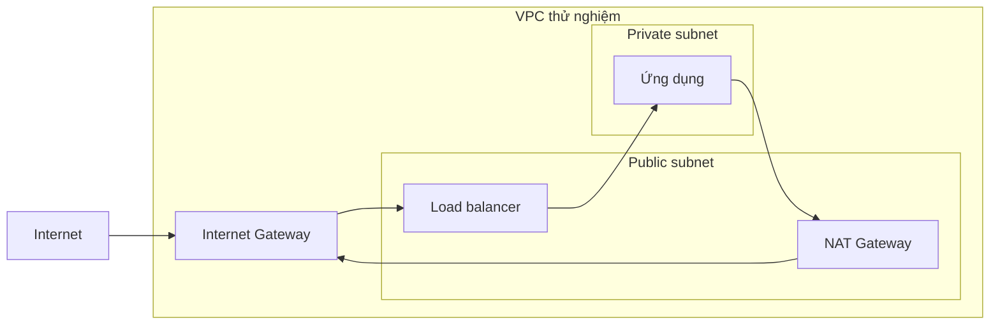

## Mở đầu: vẽ đường đi trước khi mở cổng

Khi EC2 không truy cập được một dịch vụ, thêm rule rộng vào security group thường là phản xạ đầu tiên. Nhưng nếu subnet không có route phù hợp, mở cổng cũng không đưa gói tin đến đích. Ta cần xem đồng thời đường đi, địa chỉ nguồn và điểm kiểm soát lưu lượng.

Bài này chỉ đọc cấu hình có sẵn trong tài khoản sandbox. Không tạo NAT gateway, Internet gateway hay instance, nên không hướng dẫn phát sinh tài nguyên tính phí. Bạn cần biết VPC ID và Region được phép kiểm tra; các ID dưới đây là placeholder cần thay bằng giá trị của lab.

## Nền tảng: route quyết định đường, rule quyết định quyền

Route table được liên kết với subnet và ánh xạ destination đến target. Khi nhiều route phù hợp, prefix cụ thể hơn được ưu tiên trong các trường hợp định tuyến thông thường. Subnet public có route trực tiếp đến Internet gateway; với truy cập IPv4 Internet trực tiếp, instance còn cần địa chỉ IPv4 public phù hợp. Chi tiết nằm trong [route table của VPC](https://docs.aws.amazon.com/vpc/latest/userguide/VPC_Route_Tables.html) và [các ví dụ định tuyến](https://docs.aws.amazon.com/vpc/latest/userguide/route-table-options.html).

Security group gắn với tài nguyên như network interface, có tính stateful. Network ACL kiểm soát ở mức subnet và có tính stateless. Đường phản hồi vì vậy cũng cần được xét khi có NACL tùy chỉnh. Đọc [tài liệu security group](https://docs.aws.amazon.com/vpc/latest/userguide/vpc-security-groups.html) trước khi diễn giải rule như một firewall truyền thống.

## Kiến trúc mẫu để hình dung



Sơ đồ tách traffic đi vào qua load balancer và traffic IPv4 đi ra qua NAT. NAT gateway không tự tạo đường inbound mới từ Internet vào ứng dụng. Đây là mô hình để đọc cấu hình, không phải đề xuất triển khai cho mọi hệ thống.

## Thực hành: đọc cấu hình theo thứ tự

```bash
aws sts get-caller-identity --profile sandbox --no-cli-pager
aws ec2 describe-route-tables \
  --profile sandbox --region ap-southeast-1 \
  --filters Name=vpc-id,Values=vpc-0123456789abcdef0 \
  --query 'RouteTables[*].{Id:RouteTableId,Associations:Associations,Routes:Routes}' \
  --no-cli-pager
aws ec2 describe-security-groups \
  --profile sandbox --region ap-southeast-1 \
  --filters Name=vpc-id,Values=vpc-0123456789abcdef0 \
  --no-cli-pager
```

Xác định route table thực sự dùng cho subnet, bao gồm trường hợp subnet kế thừa main route table. Sau đó tìm destination của request và target tương ứng. Cuối cùng xét rule của nguồn, đích và cổng cần truy cập. Ghi kết quả thành một chuỗi: nguồn → subnet → route → target → đích.

[CLI route tables](https://docs.aws.amazon.com/cli/latest/reference/ec2/describe-route-tables.html) và [CLI security groups](https://docs.aws.amazon.com/cli/latest/reference/ec2/describe-security-groups.html) mô tả bộ lọc, cấu trúc kết quả. Nếu có quyền, đối chiếu thêm network interface để chắc đang xem security group gắn thật với ứng dụng, không chỉ group có tên gần giống.

## Sai lầm thường gặp

- Dùng nhầm Region: kết quả rỗng dễ bị hiểu thành tài nguyên không tồn tại.
- Đặt tên subnet là “private” rồi coi tên đó quyết định khả năng truy cập: route mới phản ánh đường đi.
- Mở `0.0.0.0/0` cho SSH khi chưa chẩn đoán: tăng bề mặt truy cập mà chưa giải quyết đúng lỗi.
- Chỉ kiểm tra chiều đi: NACL hoặc thiết bị trung gian có thể chặn chiều về.

## Tổng kết

Theo gói tin từ nguồn đến đích, kiểm chứng từng liên kết bằng cấu hình đang dùng. Chỉ thay rule sau khi xác định điểm chặn và giữ phạm vi nguồn, cổng đúng nhu cầu. Cách làm này biến sự cố mạng từ phỏng đoán thành một chuỗi giả thuyết có thể loại trừ.
